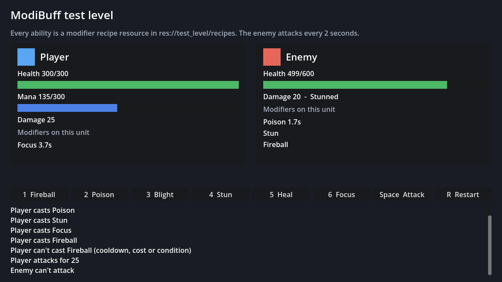

# Godot test level

A small level that uses the Godot extension end to end, made with Godot 4.8 (.NET build, needs the .NET 10 SDK).



Open the [ModiBuff.Extensions.Godot](..) folder as a project in Godot and press play, the level is the main scene.

A player fights an enemy that attacks every 2 seconds. Every player ability is a modifier recipe that's set up as a
resource in [recipes](recipes), nothing about the abilities is written in code.

| Key | Ability  | Recipe resource shows                                                       |
|-----|----------|-----------------------------------------------------------------------------|
| 1   | Fireball | Init damage. Apply cooldown and mana cost                                   |
| 2   | Poison   | Interval damage, removed after a duration, casting again refreshes it       |
| 3   | Blight   | Init damage, and an applier effect that adds Poison by name                 |
| 4   | Stun     | Status effect, the enemy can't attack while stunned                         |
| 5   | Heal     | Heal on the caster                                                          |
| 6   | Focus    | Revertible damage buff with a remove duration. Apply condition: full health |

Space attacks, R restarts the level.

The modifier lists show every modifier that's on a unit. Modifiers without a remove duration (Fireball, Blight, Stun,
Heal) stay on the unit after they did their thing, that's how ModiBuff works, casting again triggers them again.

## Files

* [TestLevelGame.cs](TestLevelGame.cs) All the ModiBuff setup and game logic, without any nodes. Start reading here.
* [TestLevel.cs](TestLevel.cs), [UnitPanel.cs](UnitPanel.cs) The scene scripts, UI only.
* [recipes](recipes) The modifier recipe resources, open them in the inspector.
* [SelfTest.cs](SelfTest.cs) Plays the level without input and checks the numbers.

## Self test

```
godot --headless --path ModiBuff/ModiBuff.Extensions.Godot --build-solutions --quit
godot --headless --path ModiBuff/ModiBuff.Extensions.Godot res://test_level/self_test.tscn
```

The first command builds the C# project (`dotnet build ModiBuff/ModiBuff.Extensions.Godot` does the same).
The second one prints a line for every test, and exits with code 1 if any of them failed.

## Things to know

* Apply checks (cooldown, cost, conditions) are not part of the recipe, the applier of a unit owns them.
  `TestLevelGame` creates them from the resources with `CreateApplyChecks` when it adds the abilities to the player.
* `Config.DefaultTag` has to be set to the Units default tag before the recipes are created,
  otherwise casts are refused because no target is legal.
* ModiBuff keeps its pools and id managers in static instances, `TestLevelGame.Shutdown` resets them,
  so the level can be restarted.
* When running from the editor, generated modifier ids are written back to the recipe resources.
  Adding or renaming a recipe will change the `Id` field of other recipe files.
